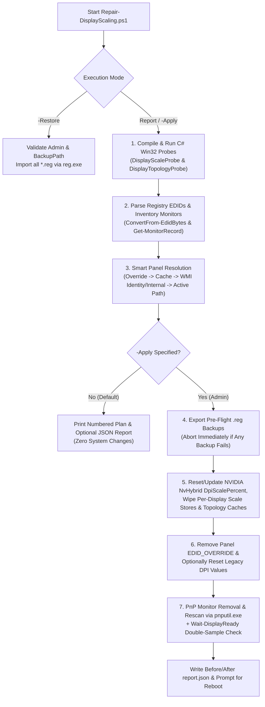

# Repair-DisplayScaling

[](./Repair-DisplayScaling.ps1)
[](./Repair-DisplayScaling.ps1)
[](./LICENSE)

**`Repair-DisplayScaling.ps1`** is a zero-dependency PowerShell diagnostic and repair utility for Windows 11/10 that detects and clears stale, mismatched, or corrupted display scaling (DPI) and monitor topology state across the Windows Registry, GPU driver persistence trees, and Plug-and-Play (PnP) device nodes.

---

## Table of Contents

* [Why This Script Exists (The Underlying Windows Bug)](#why-this-script-exists-the-underlying-windows-bug)
* [When to Use This Utility (Symptoms & Triggers)](#when-to-use-this-utility-symptoms--triggers)
* [What the Script Inspects & Repairs](#what-the-script-inspects--repairs)
* [Key Safety Guarantees](#key-safety-guarantees)
* [Quick Start & Usage](#quick-start--usage)
* [Sample Diagnostic & Repair Output](#sample-diagnostic--repair-output)
* [How to Interpret the Diagnostic Output](#how-to-interpret-the-diagnostic-output)
* [Command-Line Parameters](#command-line-parameters)
* [Layer-by-Layer Architecture](#layer-by-layer-architecture)
* [Backup Folder & JSON Report Structure](#backup-folder--json-report-structure)
* [Post-Repair Steps & Troubleshooting](#post-repair-steps--troubleshooting)
* [Requirements & License](#requirements--license)

---

## Why This Script Exists (The Underlying Windows Bug)

Windows does not store per-monitor display scaling as a simple percentage in one place. Instead, it computes and persists display scaling across five separate layers that can outlive the hardware or driver conditions under which they were recorded:

1. **Cached Internal Panel EDID** (`HKLM:\SYSTEM\CurrentControlSet\Control\GraphicsDrivers\InternalMonEdid`) — A cached copy of the built-in screen's Extended Display Identification Data (physical dimensions in cm and native pixel resolution) used to compute the baseline "Recommended" scale.
2. **Relative Per-Display Scale Offsets** (`HKCU:\Control Panel\Desktop\PerMonitorSettings` and `HKLM:\SYSTEM\CurrentControlSet\Control\GraphicsDrivers\ScaleFactors`) — Rather than storing an absolute DPI (like `144`) or percentage (like `150%`), Windows keys each subkey by the monitor's 7-character EDID identity prefix (e.g., `BOE095F...`) and stores a `DpiValue` DWORD representing **relative steps** away from the panel's computed "Recommended" baseline (`0` = Recommended, `1` = +1 step up, `4294967295` [`-1`] = 1 step down).
3. **Display Topology & Connectivity Caches** (`Configuration` and `Connectivity` under `HKLM:\SYSTEM\CurrentControlSet\Control\GraphicsDrivers`) — Remembered single- and multi-monitor target layouts and mode histories.
4. **NVIDIA Hybrid Graphics (Optimus / Advanced Optimus) Persistence** (`HKLM:\SYSTEM\CurrentControlSet\Services\nvlddmkm\Parameters\Global\NvHybrid\Persistence`) — Kernel-driver `DpiScalePercent` state persisted across iGPU/dGPU MUX transitions.
5. **Legacy DPI Fallback Values & EDID Overrides** (`HKCU:\Control Panel\Desktop` values `LogPixels`, `Win8DpiScaling`, `DesktopDPIOverride`, and per-monitor `Device Parameters\EDID_OVERRIDE` blobs).

### Why Standard Troubleshooting Fails
When any of these layers become stale or mismatched with the connected display:
* **Everything on screen looks abnormally large or small** even while running at the correct native pixel resolution.
* **Settings > System > Display > Custom Scaling still reports `"Unmodified default"`**, because no custom global override is active—Windows is dutifully applying a relative step offset (or `0` offset) on top of a stale panel EDID baseline or hybrid GPU persistence value.
* **Clean GPU driver reinstalls—even with Display Driver Uninstaller (DDU)—do not fix it**, because DDU strips GPU driver files and service keys while leaving Windows' `InternalMonEdid`, CCD topology caches, and `HKCU` per-monitor DPI stores intact.

`Repair-DisplayScaling.ps1` queries the live, unvirtualized hardware state via inline C# Win32 APIs, compares it against every persistent Registry store, plans the exact repairs required, and applies them only when asked—with automatic `.reg` backups and one-command rollback.

---

## When to Use This Utility (Symptoms & Triggers)

### Common Symptoms
* UI elements, text, taskbar icons, and window chrome appear oversized or tiny at native resolution.
* The **Recommended** scale percentage in **Settings > System > Display** is wrong for your screen's actual physical pixel density (PPI), or changing the scale slider fails to restore normal proportions.
* `GetDpiForMonitor` / `GetDpiForSystem` reports an effective DPI that contradicts the monitor's physical dimensions.

### Common Triggers
* **SSD / OS Transplant:** Moving a Windows NVMe/SSD installation to another laptop/PC, or restoring a system image onto different hardware (the Registry display caches travel with the disk while the physical panel does not).
* **Hardware Replacement:** Replacing a laptop's internal LCD/OLED panel (e.g., swapping a 1080p panel for a 1440p/4K panel or a different manufacturer's panel), display cable, or motherboard.
* **GPU Driver & MUX Changes:** Updating, rolling back, or reinstalling iGPU/dGPU drivers, or switching between NVIDIA Optimus, Advanced Optimus (Dynamic Display Switch), and discrete-only MUX modes.
* **Docking & Multi-Monitor Transitions:** Switching between docked and undocked configurations, or an interrupted shutdown/crash while Windows was writing display configuration keys.
* **Third-Party Tools & Overrides:** Leftover `EDID_OVERRIDE` registry blobs or manual edits to legacy `HKCU:\Control Panel\Desktop` DPI values.

---

## What the Script Inspects & Repairs

| Subsystem / Store | Registry Path / System Target | Role in Windows Display Stack | Action on `-Apply` |
| :--- | :--- | :--- | :--- |
| **Live Monitor & System DPI** | `user32.dll` / `shcore.dll` (`GetDpiForMonitor`, `GetDpiForSystem`) | Active unvirtualized per-monitor DPI (`MDT_EFFECTIVE_DPI`) and system DPI | Read-only before & after verification |
| **Active CCD Display Paths** | `user32.dll` (`QueryDisplayConfig`, `DisplayConfigGetDeviceInfo`) | Live GPU source-to-target routing, output technology, and target EDID IDs | Read-only topology & panel matching |
| **Internal Panel EDID Cache** | `HKLM:\SYSTEM\CurrentControlSet\Control\GraphicsDrivers\InternalMonEdid` | Cached 128-byte EDID for the built-in panel; flags `stale: yes` on mismatch | Backed up (`InternalMonEdid.reg`) and key deleted |
| **User Per-Monitor Scale** | `HKCU:\Control Panel\Desktop\PerMonitorSettings` | Per-user relative `DpiValue` step offsets keyed by `<7-char EDID ID>...` | Backed up (`PerMonitorSettings.reg`) and deleted (all or active panel prefix only) |
| **Machine Per-Monitor Scale** | `HKLM:\SYSTEM\CurrentControlSet\Control\GraphicsDrivers\ScaleFactors` | System-wide relative `DpiValue` step offsets keyed by `<7-char EDID ID>...` | Backed up (`ScaleFactors.reg`) and deleted (all or active panel prefix only) |
| **Display Topology Caches** | `HKLM:\...\GraphicsDrivers\Configuration`<br/>`HKLM:\...\GraphicsDrivers\Connectivity` | Remembered single/multi-monitor layouts, modes, and connection history | Backed up (`Configuration.reg`, `Connectivity.reg`) and keys deleted |
| **NVIDIA Hybrid Persistence** | `HKLM:\SYSTEM\CurrentControlSet\Services\nvlddmkm\Parameters\Global\NvHybrid\Persistence` | `DpiScalePercent` value persisted across iGPU/dGPU Optimus transitions | Backed up (`NvHybrid.reg`) and value deleted (or updated to `-NvidiaScalePercent`) |
| **Panel EDID Override** | `HKLM:\SYSTEM\CurrentControlSet\Enum\DISPLAY\<MonitorId>\<Instance>\Device Parameters` | `EDID_OVERRIDE` binary value overriding hardware EDID reporting | Backed up (`Enum_<MonitorId>_<Instance>.reg`) and `EDID_OVERRIDE` removed on identified panel |
| **Legacy Desktop DPI** | `HKCU:\Control Panel\Desktop` (`LogPixels`, `Win8DpiScaling`, `DesktopDPIOverride`) | Legacy system-wide DPI scaling values | Backed up (`HKCU_Desktop.reg`) and reset **only** when `-ResetLegacyDpiValues` is set |
| **System Font DPI** | `HKLM:\SOFTWARE\Microsoft\Windows NT\CurrentVersion\FontDPI` (`LogPixels`) | Machine-level legacy font DPI reference | Read-only diagnostic inspection |
| **PnP Monitor Device Node** | `DISPLAY\<MonitorId>\<Instance>` via `pnputil.exe` | Active Device Manager monitor node and cached `Device Parameters\EDID` | Removed (`/remove-device`) and rescanned (`/scan-devices`) unless skipped |

---

## Key Safety Guarantees

* **100% Read-Only by Default:** Running `.\Repair-DisplayScaling.ps1` without `-Apply` makes **zero changes**. It audits all hardware and Registry layers and outputs the exact numbered plan it *would* execute.
* **All-or-Nothing Pre-Flight Backup:** Before `-Apply` modifies or deletes any key, every targeted Registry branch is exported via `reg.exe export` to `Desktop\DisplayScaleRepair_<yyyyMMdd-HHmmss>`. **If even a single backup fails (`$script:BackupFailures -gt 0`), the script aborts immediately before making any changes.**
* **Multi-Monitor Ambiguity Guard:** If multiple monitors match the panel detection criteria and cannot be uniquely distinguished, `$ambiguousPanel` is triggered and panel-specific operations (`EDID_OVERRIDE` deletion, selective scale removal, and `pnputil` device removal) are automatically skipped unless you explicitly identify the panel via `-MonitorInstanceId`.
* **Corrupt-EDID Recovery via `-MonitorInstanceId`:** While auto-discovery requires both a single matched device and a valid readable EDID identity (`$panelIdentityKnown`), explicitly passing `-MonitorInstanceId` overrides both checks—allowing you to strip a corrupt `EDID_OVERRIDE` and force a `pnputil` device rescan even when the panel's Registry EDID is unreadable.
* **Literal Prefix Matching:** When `-PreserveExternalMonitorSettings` is active, scale store subkeys are matched using `[System.StringComparison]::OrdinalIgnoreCase` literal prefix checks against the 7-character EDID identity rather than wildcard patterns, ensuring malformed EDID bytes can never act as wildcards.
* **No Phantom NVIDIA Key Creation:** If `-NvidiaScalePercent` is passed on a system where `NvHybrid\Persistence` does not already contain a `DpiScalePercent` value, the script warns and refuses to create a new value from scratch.
* **One-Command Rollback (`-Restore`):** Re-imports all `.reg` backup files from a previous run via `reg.exe import`.
* **Structured JSON Audit Trail:** Writes a strict UTF-8 (without BOM) `report.json` into the backup folder containing full `before` and `after` state snapshots, executed actions, warnings, and errors.

---

## Quick Start & Usage

> [!TIP]
> If you downloaded the script directly from a browser, unblock the file and allow execution for the current PowerShell process first:
> ```powershell
> Unblock-File -Path .\Repair-DisplayScaling.ps1
> Set-ExecutionPolicy -Scope Process -ExecutionPolicy Bypass
> ```

### 1. Audit Only (Safe Dry Run)
Run in any PowerShell console to inspect your live DPI state, decoded EDID metadata, stale cache flags, and the planned repair steps without modifying the system:

```powershell
.\Repair-DisplayScaling.ps1
```

Include a deep scan of 9 graphics/vendor registry trees and export the read-only diagnostic state to a JSON file:

```powershell
.\Repair-DisplayScaling.ps1 -DeepScan -ReportPath .\display-audit.json
```

### 2. Apply Repairs (Requires Administrator)
Open an **elevated (Administrator) PowerShell** window and run with `-Apply`:

```powershell
.\Repair-DisplayScaling.ps1 -Apply
```

Unless `-Force` is passed, the script displays the backup destination and planned operations, then prompts `Type YES to apply these changes` before proceeding.

> [!IMPORTANT]
> **Always reboot after running `-Apply`** before judging the display scale. Windows reloads `InternalMonEdid`, `ScaleFactors`, and `PerMonitorSettings` during session/boot initialization.

### 3. Common Repair Scenarios

**Unattended full repair (including legacy DPI reset, deep scan, and automatic reboot):**
```powershell
.\Repair-DisplayScaling.ps1 -Apply -ResetLegacyDpiValues -DeepScan -Reboot -Force
```

**Repair only the built-in laptop panel while preserving external monitor scale settings:**
```powershell
.\Repair-DisplayScaling.ps1 -Apply -PreserveExternalMonitorSettings
```

**Explicitly target a specific monitor instance ID (when multiple external monitors are connected or the panel's EDID is corrupt):**
```powershell
.\Repair-DisplayScaling.ps1 -Apply -MonitorInstanceId "DISPLAY\BOE095F\4&12345678&0&UID256"
```

**Update an existing NVIDIA Hybrid Graphics scale value to a specific percentage (`100`–`500`) instead of deleting it:**
```powershell
.\Repair-DisplayScaling.ps1 -Apply -NvidiaScalePercent 125
```

**Roll back all Registry changes from a previous backup folder:**
```powershell
.\Repair-DisplayScaling.ps1 -Restore -BackupPath "$HOME\Desktop\DisplayScaleRepair_20261018-120000"
```

---

## Sample Diagnostic & Repair Output

Running `.\Repair-DisplayScaling.ps1` (without `-Apply`) produces a read-only console audit. The example below shows a laptop after an internal panel replacement from `AUO21ED` to `BOE095F`, where `InternalMonEdid` (`stale: yes`), `PerMonitorSettings`, and NVIDIA `NvHybrid\Persistence` still hold stale scaling data:

```text
== System
   LENOVO 82RG
   BIOS JUCN55WW 09/15/2025 00:00:00
   Elevated: True

== Effective scale
   \\.\DISPLAY1  DPI 168x168  175%  2560x1600
   System DPI: 168

== Active display paths
   Target 0x100  tech 0x80000000  edid 0x09E5:0x095F  \\?\DISPLAY#BOE095F#4&12345678&0&UID256#{e6f07b5f-ee97-4a90-b076-33f57bf4eaa7}

== Panel
   Identity: BOE095F
   EDID: BOE product 0x095F  34x22 cm  15.9 in  190 PPI
   Monitor devices: DISPLAY\BOE095F\4&12345678&0&UID256
   Matched by: wmi-identity

== Monitor devices
   DISPLAY\BOE095F\4&12345678&0&UID256  OK  EDID BOE095F  override no
   DISPLAY\AUO21ED\4&87654321&0&UID256  Not present  EDID AUO21ED  override no

== Internal panel EDID cache
   0  AUO21ED  stale: yes

== Per-display scale state
   User  AUO21ED_0_07E5_6A  DpiValue 4294967295
   Machine  BOE095F_0_07E6_95  DpiValue 0

== NVIDIA hybrid graphics
   HKLM:\SYSTEM\CurrentControlSet\Services\nvlddmkm\Parameters\Global\NvHybrid\Persistence  DpiScalePercent 175

== Legacy DPI values
   HKCU LogPixels: 168  Win8DpiScaling: 0  DesktopDPIOverride:
   HKLM FontDPI LogPixels: 96

== Plan
   Run with -Apply to perform these changes:
   1. Export the display registry keys that will be touched.
   2. Remove the internal panel EDID cache and the topology caches.
   3. Remove all per-display scale entries.
   4. Remove the NVIDIA hybrid graphics scale value when present.
   5. Remove and rescan the active panel monitor device.
   6. Re-read the state, write a report, and ask for a reboot.

   No change was made.
```

<details>
<summary><strong>View sample <code>-Apply</code> execution output (click to expand)</strong></summary>

```text
== Plan
   Backup folder: C:\Users\User\Desktop\DisplayScaleRepair_20261018-120000
   Panel identity: BOE095F
   Panel identified by: wmi-identity
   Monitor devices to rescan: DISPLAY\BOE095F\4&12345678&0&UID256
   NVIDIA scale value will be removed when present.
   All per-display scale entries will be removed.
   The internal panel EDID cache and topology caches will be removed.

Type YES to apply these changes: YES

== Backup

== NVIDIA hybrid graphics
   Removed HKLM:\SYSTEM\CurrentControlSet\Services\nvlddmkm\Parameters\Global\NvHybrid\Persistence DpiScalePercent

== Display state
   Removed the per-display scale stores that were present.
   Removed the display caches that were present.

== Panel EDID override
   No EDID override was present on the identified panel device.

== Monitor rescan
   Monitor devices removed: 1

== State after the changes
   \\.\DISPLAY1  DPI 144x144  150%
   System DPI: 168
   Internal panel cache entries: 0
   Scale entries: 0
   NVIDIA hybrid graphics scale: none
   Report written to C:\Users\User\Desktop\DisplayScaleRepair_20261018-120000\report.json

== Next steps
   Reboot before judging the result.
   After the reboot, open Settings > System > Display and set Scale to Recommended or to the size you want.
   If the scale is still wrong, run the script again with -DeepScan and check the NVIDIA hybrid graphics scale value.
   Other causes to check by hand: a vendor display utility, the GPU control panel MUX mode, or an outdated GPU driver.
```
</details>

---

## How to Interpret the Diagnostic Output

* **`Effective scale` vs. `System DPI`:** `Effective scale` reports the live per-monitor hardware DPI returned by `GetDpiForMonitor` (`96` = 100%, `120` = 125%, `144` = 150%, `168` = 175%, `192` = 200%). `System DPI` reports the primary session DPI latched at sign-in (`GetDpiForSystem`). A mismatch between the two before any changes indicates that display scaling was altered after the current session started.
* **`Active display paths` (`tech` & `edid`):** Shows the live CCD routing table. `tech 0x80000000` (`D3DKMDT_VOT_INTERNAL`) or `tech 0xB` (`11`, `D3DKMDT_VOT_DISPLAYPORT_EMBEDDED` / eDP) indicates an internal laptop panel; `tech 0x5` (HDMI) or `tech 0xA` (external DisplayPort) indicates an external monitor.
* **`Internal panel EDID cache` (`stale: yes`):** Compares each cached EDID under `GraphicsDrivers\InternalMonEdid` against the active panel's hardware EDID identity. If `stale: yes` appears, Windows is holding onto cached panel dimensions from a previous screen or machine.
* **`Per-display scale state` (`DpiValue`):** Shows saved relative step offsets in `PerMonitorSettings` (User) and `ScaleFactors` (Machine). `0` means Windows' computed "Recommended" step; `1`, `2`, ... mean steps above Recommended; unsigned 32-bit values near `2^32` such as `4294967295` (`-1`) or `4294967294` (`-2`) represent negative step offsets below Recommended.
* **`NVIDIA hybrid graphics` (`DpiScalePercent`):** If present, the NVIDIA kernel driver (`nvlddmkm`) has persisted a hybrid-graphics scale percentage under `NvHybrid\Persistence` that can override standard Windows DPI settings across MUX/Optimus switches.

---

## Command-Line Parameters

| Parameter | Type | Default | Description |
| :--- | :--- | :--- | :--- |
| `-Apply` | `switch` | `false` | Executes the planned repairs. Without `-Apply`, the script runs strictly in read-only report mode. Requires Administrator privileges. |
| `-Force` | `switch` | `false` | Suppresses interactive `Type YES` confirmation prompts before applying changes or restarting the system. |
| `-BackupPath` | `string` | `Desktop\DisplayScaleRepair_<timestamp>` | Target folder for `.reg` exports and `report.json` during `-Apply` (falls back to `$env:TEMP` if Desktop is unavailable), or the source folder when running `-Restore`. |
| `-PreserveExternalMonitorSettings` | `switch` | `false` | Deletes only per-display scale entries whose key name begins with the active panel's EDID identity (e.g., `BOE095F`), preserving saved scale settings for external monitors. |
| `-ResetLegacyDpiValues` | `switch` | `false` | Backs up `HKCU:\Control Panel\Desktop`, sets `LogPixels = 96` (DWORD) and `Win8DpiScaling = 0` (DWORD), and removes `DesktopDPIOverride`. |
| `-SkipMonitorReenumerate` | `switch` | `false` | Skips removing and rescanning the active panel's PnP monitor device node via `pnputil.exe`. |
| `-SkipNvidiaPersistenceReset` | `switch` | `false` | Leaves the NVIDIA hybrid graphics `DpiScalePercent` registry value untouched. |
| `-NvidiaScalePercent` | `Nullable[int]` | `$null` | Writes a custom scale percentage (`100`–`500`) to existing NVIDIA `DpiScalePercent` value(s) instead of deleting them. Ignored with a warning if `-SkipNvidiaPersistenceReset` is set. |
| `-MonitorInstanceId` | `string[]` | `$null` | Explicitly selects one or more monitor device instance IDs (e.g., `DISPLAY\BOE095F\...`) as the target panel instead of running automatic discovery. |
| `-Restore` | `switch` | `false` | Imports all `.reg` files found in `-BackupPath` via `reg.exe import` and exits immediately. Requires Administrator privileges. |
| `-Reboot` | `switch` | `false` | Restarts the computer via `Restart-Computer -Force` after `-Apply` completes (prompts for confirmation unless `-Force` is specified). |
| `-DeepScan` | `switch` | `false` | Walks 9 display/vendor registry trees to catalog up to 200 binary EDID structures (printing the first 30) and up to 200 value names containing `dpi` or `scale`. |
| `-ReportPath` | `string` | `""` | File path for saving the JSON diagnostic report when running in read-only mode (without `-Apply`). When `-Apply` is used, the report is automatically saved to `<BackupPath>\report.json`. |

### Parameter Validation & Mutual-Exclusion Safeguards
* **`-Restore` Isolation ([Lines 1016–1034](./Repair-DisplayScaling.ps1#L1016-L1034)):** When `-Restore` is passed, any repair/audit switches (`-Apply`, `-Reboot`, `-PreserveExternalMonitorSettings`, `-ResetLegacyDpiValues`, `-SkipMonitorReenumerate`, `-SkipNvidiaPersistenceReset`, `-NvidiaScalePercent`, `-MonitorInstanceId`, `-DeepScan`, `-ReportPath`) are ignored with an explicit warning so a restore operation can never trigger a partial repair or reboot automatically.
* **Path Sanity Checks ([Lines 1030–1031](./Repair-DisplayScaling.ps1#L1030-L1031), [1306–1310](./Repair-DisplayScaling.ps1#L1306-L1310)):** Verifies that `-BackupPath` is a directory (and not an existing file) before attempting either `-Apply` or `-Restore`.
* **Range Validation ([Lines 1072–1075](./Repair-DisplayScaling.ps1#L1072-L1075)):** Enforces `$NvidiaScalePercent -ge 100 -and $NvidiaScalePercent -le 500` before execution begins.

---

## Layer-by-Layer Architecture



### 1. Embedded Win32 C# Probes ([Lines 236–459](./Repair-DisplayScaling.ps1#L236-L459))
Standard PowerShell cmdlets are subject to process-level DPI virtualization and cannot access low-level Connecting and Configuring Displays (CCD) Win32 structures. The script compiles two inline C# classes (`DisplayRepair.DisplayScaleProbe` and `DisplayRepair.DisplayTopologyProbe`) via `Add-Type` (checking `PSTypeName` first on [lines 455–459](./Repair-DisplayScaling.ps1#L455-L459) so repeated runs in the same PowerShell session do not fail on duplicate type compilation):
* **Bypassing DPI Virtualization (`SetProcessDpiAwarenessContext`):** Enforces `-4` (`DPI_AWARENESS_CONTEXT_PER_MONITOR_AWARE_V2`) and verifies the active thread context via `GetAwarenessFromDpiAwarenessContext`. If awareness level `2` (`DPI_AWARENESS_PER_MONITOR_AWARE`) is not active ([line 1144](./Repair-DisplayScaling.ps1#L1144)), the script emits a warning that reported DPI numbers may be virtualized.
* **Per-Monitor & System DPI (`EnumDisplayMonitors` & `GetDpiForMonitor`):** Enumerates every active monitor handle, calls `GetMonitorInfo` for screen bounds and primary flags, queries `shcore.dll!GetDpiForMonitor` (`MDT_EFFECTIVE_DPI = 0`) for exact horizontal/vertical DPI, calculates the percentage (`dpiX * 100 / 96`), and queries `GetDpiForSystem()`.
* **Active Display Topology (`QueryDisplayConfig` & `DisplayConfigGetDeviceInfo`):** Queries active display paths (`QDC_ONLY_ACTIVE_PATHS = 2`) with an automatic 250ms retry ([lines 1095–1100](./Repair-DisplayScaling.ps1#L1095-L1100)) if a transient error or empty device path occurs. Because the `DISPLAYCONFIG_TARGET_DEVICE_NAME` structure size varies across Windows builds, `TryReadName` ([lines 408–446](./Repair-DisplayScaling.ps1#L408-L446)) tests 8 candidate struct sizes (`420, 424, 428, 432, 436, 440, 444, 448` bytes) until the call succeeds, Base64-encodes the Unicode monitor name and GDI device path for safe pipe-delimited transport, and byte-swaps the 16-bit manufacturer ID at offset 28 (`(rawMfg >> 8) | (rawMfg << 8)`) to match registry EDID byte order.

### 2. Binary EDID Parsing & Deep Registry Scanning ([Lines 461–896](./Repair-DisplayScaling.ps1#L461-L896))
* **Integrated EDID Parser (`ConvertFrom-EdidBytes`, [Lines 461–514](./Repair-DisplayScaling.ps1#L461-L514)):** Parses raw 128+ byte Extended Display Identification Data (EDID) blocks directly from the Registry. It verifies that the value is a `[byte[]]` of at least 128 bytes starting with the 8-byte EDID magic header (`00 FF FF FF FF FF FF 00`), validates the modulo-256 checksum across bytes `0..127`, decodes the 5-bit compressed 3-letter PNP Manufacturer ID (`Bytes[8..9]`) and little-endian hex Product Code (`Bytes[10..11]`) into a canonical 7-character identity string (e.g., `BOE095F`), extracts manufacture week/year (`1990 + Bytes[17]`), physical width/height in cm (`Bytes[21..22]`), and native horizontal/vertical active pixels from the first Detailed Timing Descriptor (`Bytes[56..61]`), and computes physical **diagonal inches** and **PPI**.
* **Monitor Device Inventory (`Get-MonitorRecord`, [Lines 604–663](./Repair-DisplayScaling.ps1#L604-L663)):** Enumerates all subkeys under `HKLM:\SYSTEM\CurrentControlSet\Enum\DISPLAY`, correlates each `DISPLAY\<MonitorId>\<Instance>` path with live `Get-PnpDevice -Class Monitor` status and `ContainerID`, and parses both `EDID` and any custom `EDID_OVERRIDE` under `Device Parameters`.
* **Stack-Based Deep Registry Scan (`-DeepScan`, [Lines 805–896](./Repair-DisplayScaling.ps1#L805-L896)):** When `-DeepScan` is passed, `Find-EdidValue` and `Find-DpiValueName` perform a non-recursive stack traversal across 9 registry roots:
  * **EDID Search Roots:** `GraphicsDrivers`, `Video`, Display Adapter class `{4d36e968-e325-11ce-bfc1-08002be10318}`, Monitor class `{4d36e96e-e325-11ce-bfc1-08002be10318}`, `Services\nvlddmkm`, `Services\amdkmdag`, `SOFTWARE\NVIDIA Corporation`, `SOFTWARE\AMD`, and `Enum\DISPLAY`.
  * **DPI/Scale Name Search Roots:** `HKCU:\Control Panel`, `HKCU` & `HKLM` `Software\Microsoft\Windows\CurrentVersion`, `NVIDIA Corporation`, `AMD`, `GraphicsDrivers`, `Video`, `nvlddmkm`, and `DeviceContainers` (matching `(?i)dpi` or `(?i)scale` while excluding false positives matching `(?i)upscale|tailscale|gamma`).

### 3. Smart Panel Matching Engine (`Resolve-Panel`, [Lines 665–735](./Repair-DisplayScaling.ps1#L665-L735))
Rather than blindly modifying all monitors on a multi-display system, `Resolve-Panel` isolates the target active/internal panel using a step-down priority matrix:
1. **`override`:** Explicit monitor instance IDs passed by the user via `-MonitorInstanceId`.
2. **`cache`:** Active display paths whose EDID identity matches a valid cached entry in `HKLM:\SYSTEM\CurrentControlSet\Control\GraphicsDrivers\InternalMonEdid` (intersected with `$activeIds` so a stale cache entry can never select a disconnected monitor).
3. **`wmi-identity` / `wmi-internal`:** Queries `root\wmi:WmiMonitorConnectionParams` for physical built-in panel connection flags (`VideoOutputTechnology` equal to `2147483648` [`0x80000000`, `D3DKMDT_VOT_INTERNAL`] or `11` [`D3DKMDT_VOT_DISPLAYPORT_EMBEDDED` / eDP]).
   * If an active CCD path shares the WMI internal monitor's EDID identity (even across different GPU adapter instances on hybrid/MUX laptops), it matches via **`wmi-identity`**.
   * Otherwise, it falls back directly to the WMI-identified internal monitor record via **`wmi-internal`**.
4. **`active-path`:** Falls back to active CCD display paths if WMI or cache data is unavailable.
* **Ambiguity & Identity Safeguard ([Lines 1108–1118](./Repair-DisplayScaling.ps1#L1108-L1118)):** The script tracks device matching (`$panelDeviceIds.Count`) separately from EDID readability (`$panelIdentityKnown`). If auto-discovery matches multiple monitor devices (`$ambiguousPanel = $true`), zero devices, or a device with an unreadable EDID, `$panelIdentified` evaluates to `$false` and panel-specific destructive steps are skipped with a specific reason (`$panelSkipReason`):
  * `'the panel could not be told apart from other displays'`
  * `'no monitor device matched the panel'`
  * `'the panel identity could not be read'`

### 4. Repair & Reset Operations (`-Apply`, [Lines 1306–1503](./Repair-DisplayScaling.ps1#L1306-L1503))
Passing `-Apply` executes the repair pipeline in strict order:
1. **All-or-Nothing Pre-Flight Backup ([Lines 1363–1381](./Repair-DisplayScaling.ps1#L1363-L1381)):** Normalizes PowerShell provider paths via `ConvertTo-RegPath` ([lines 165–181](./Repair-DisplayScaling.ps1#L165-L181)) and invokes `reg.exe export ... /y` to back up `InternalMonEdid`, `ScaleFactors`, `Configuration`, `Connectivity`, `PerMonitorSettings`, `NvHybrid`, and every `Enum\DISPLAY\<MonitorId>` branch. **If `$script:BackupFailures -gt 0`, execution halts immediately before any registry modification occurs.**
2. **NVIDIA Hybrid Graphics Persistence Reset ([Lines 1383–1409](./Repair-DisplayScaling.ps1#L1383-L1409)):** Searches `HKLM:\SYSTEM\CurrentControlSet\Services\nvlddmkm\Parameters\Global\NvHybrid\Persistence` (both the root key and all subkeys) for `DpiScalePercent` and removes the property—or updates existing entry values to `-NvidiaScalePercent` (`100`–`500`) if specified.
3. **Per-Display Scale & Topology Cache Purge ([Lines 1411–1449](./Repair-DisplayScaling.ps1#L1411-L1449)):**
   * Removes `HKLM:\SYSTEM\CurrentControlSet\Control\GraphicsDrivers\ScaleFactors` and `HKCU:\Control Panel\Desktop\PerMonitorSettings`—or, when `-PreserveExternalMonitorSettings` is active, removes only individual subkeys whose name starts with `$panel.Identity`.
   * Removes `InternalMonEdid`, `Configuration`, and `Connectivity` under `HKLM:\SYSTEM\CurrentControlSet\Control\GraphicsDrivers`.
4. **Panel EDID Override Removal ([Lines 1450–1484](./Repair-DisplayScaling.ps1#L1450-L1484)):** For each matched record on an unambiguously identified panel that has an `EDID_OVERRIDE`, exports an instance-specific `.reg` backup (`Enum_<MonitorId>_<InstanceName>.reg`) and removes `EDID_OVERRIDE` from `Device Parameters` (leaving the override untouched if that instance backup fails).
5. **Legacy DPI Reset (`Reset-LegacyDpiValues`, [Lines 972–992](./Repair-DisplayScaling.ps1#L972-L992), [1486–1492](./Repair-DisplayScaling.ps1#L1486-L1492)):** When `-ResetLegacyDpiValues` is passed, exports `HKCU_Desktop.reg`, sets `LogPixels = 96` and `Win8DpiScaling = 0`, and removes `DesktopDPIOverride`.

### 5. PnP Hardware Re-Enumeration, Verification & Rollback ([Lines 551–566](./Repair-DisplayScaling.ps1#L551-L566), [898–970](./Repair-DisplayScaling.ps1#L898-L970), [994–1065](./Repair-DisplayScaling.ps1#L994-L1065), [1505–1587](./Repair-DisplayScaling.ps1#L1505-L1587))
Instead of only editing the Registry, the script forces Windows' Plug-and-Play subsystem to tear down and rebuild the monitor device node from the physical panel's firmware:
* **Device Tear-Down & Rescan (`Invoke-MonitorReenumerate`, [Lines 898–970](./Repair-DisplayScaling.ps1#L898-L970)):** Runs `pnputil.exe /remove-device "<InstanceId>"` on each identified panel instance, then triggers `pnputil.exe /scan-devices`. Because Windows may assign a new instance suffix when re-enumerating the monitor, the script extracts the hardware prefix (`DISPLAY\<HardwareId>\`) and polls `Get-PnpDevice -Class Monitor` every 500ms for up to 15 seconds until a matching monitor device reappears.
* **Double-Sampled Stability Wait (`Wait-DisplayReady`, [Lines 551–566](./Repair-DisplayScaling.ps1#L551-L566)):** Polls `Get-EffectiveScale -Quiet` every 500ms (up to 10 seconds) until at least one monitor reports a healthy DPI query (`Result -eq 0`) and **two consecutive samples** return the exact same sorted `Device|Result|DpiX` signature.
* **JSON Report Serialization (`Save-Report`, [Lines 994–1014](./Repair-DisplayScaling.ps1#L994-L1014)):** Resolves PowerShell provider paths via `$ExecutionContext.SessionState.Path.GetUnresolvedProviderPathFromPSPath` and writes the full diagnostic or before/after repair object (`ConvertTo-Json -Depth 8`) using `[System.Text.UTF8Encoding]::new($false)` (UTF-8 without BOM) for strict JSON parser compatibility.
* **Automated Rollback (`-Restore`, [Lines 1016–1065](./Repair-DisplayScaling.ps1#L1016-L1065)):** Validates Administrator elevation and `-BackupPath`, warns about any ignored operational flags, imports every `*.reg` file in the backup folder via `reg.exe import` (merging all deleted keys, scale stores, `EDID_OVERRIDE` blobs, and original values back into the Registry), reports success/failure counts, and reminds you to reboot.

---

## Backup Folder & JSON Report Structure

When run with `-Apply`, the backup directory (`Desktop\DisplayScaleRepair_<yyyyMMdd-HHmmss>`) contains:

```text
DisplayScaleRepair_20261018-120000/
├── Configuration.reg                # HKLM\...\GraphicsDrivers\Configuration (if present)
├── Connectivity.reg                 # HKLM\...\GraphicsDrivers\Connectivity (if present)
├── InternalMonEdid.reg              # HKLM\...\GraphicsDrivers\InternalMonEdid (if present)
├── ScaleFactors.reg                 # HKLM\...\GraphicsDrivers\ScaleFactors (if present)
├── PerMonitorSettings.reg           # HKCU\Control Panel\Desktop\PerMonitorSettings (if present)
├── NvHybrid.reg                     # HKLM\...\nvlddmkm\Parameters\Global\NvHybrid (if present)
├── Enum_DISPLAY_<MonitorId>.reg     # Per-model HKLM\SYSTEM\CurrentControlSet\Enum\DISPLAY\<MonitorId>
├── Enum_<MonitorId>_<Instance>.reg  # Instance backup created before removing EDID_OVERRIDE (if present)
├── HKCU_Desktop.reg                 # Created when -ResetLegacyDpiValues is used
└── report.json                      # Full UTF-8 (no BOM) audit log of before/after state & actions
```

<details>
<summary><strong>View <code>report.json</code> top-level schema (click to expand)</strong></summary>

In **`Report` mode** (`-ReportPath <file>`):
```json
{
  "timestamp": "2026-10-18T12:00:00.0000000+02:00",
  "mode": "Report",
  "elevated": true,
  "scale": { "Monitors": [...], "SystemDpi": 168, "Awareness": 2 },
  "paths": [...],
  "panel": { "Records": [...], "Identity": "BOE095F", "InstanceIds": [...], "Selection": "wmi-identity", "ActiveRecordCount": 1 },
  "monitors": [...],
  "internalPanelEdid": [...],
  "scaleEntries": [...],
  "nvidia": [...],
  "legacy": { "LogPixels": 168, "Win8DpiScaling": 0, "DesktopDPIOverride": null, "FontDpiLogPixels": 96 },
  "deepScan": null,
  "warnings": [],
  "errors": []
}
```

In **`Apply` mode** (`<BackupPath>\report.json`):
```json
{
  "timestamp": "2026-10-18T12:00:15.0000000+02:00",
  "mode": "Apply",
  "elevated": true,
  "backupFolder": "C:\\Users\\User\\Desktop\\DisplayScaleRepair_20261018-120000",
  "before": {
    "scale": {...},
    "paths": [...],
    "panel": {...},
    "monitors": [...],
    "internalPanelEdid": [...],
    "scaleEntries": [...],
    "nvidia": [...],
    "legacy": {...},
    "deepScan": null
  },
  "after": {
    "scale": {...},
    "paths": [...],
    "internalPanelEdid": [],
    "scaleEntries": [],
    "nvidia": [],
    "legacy": {...}
  },
  "actions": [
    "Backup: C:\\Users\\User\\Desktop\\DisplayScaleRepair_20261018-120000\\InternalMonEdid.reg",
    "Removed NVIDIA DpiScalePercent at HKLM:\\SYSTEM\\CurrentControlSet\\Services\\nvlddmkm\\Parameters\\Global\\NvHybrid\\Persistence",
    "Removed key: HKLM:\\SYSTEM\\CurrentControlSet\\Control\\GraphicsDrivers\\ScaleFactors",
    "Removed key: HKCU:\\Control Panel\\Desktop\\PerMonitorSettings",
    "Removed key: HKLM:\\SYSTEM\\CurrentControlSet\\Control\\GraphicsDrivers\\InternalMonEdid",
    "Removed key: HKLM:\\SYSTEM\\CurrentControlSet\\Control\\GraphicsDrivers\\Configuration",
    "Removed key: HKLM:\\SYSTEM\\CurrentControlSet\\Control\\GraphicsDrivers\\Connectivity",
    "Removed monitor device: DISPLAY\\BOE095F\\4&12345678&0&UID256",
    "Rescanned display devices."
  ],
  "warnings": [],
  "errors": []
}
```
</details>

---

## Post-Repair Steps & Troubleshooting

1. **Reboot Immediately After `-Apply`:** Do not judge the visual scale or open Display Settings to tweak scaling until you have restarted Windows.
2. **Verify Scale in Windows Settings:** After rebooting, open **Settings > System > Display** and set **Scale** to the **Recommended** value (or your preferred percentage).
3. **If Scaling Is Still Wrong After Rebooting:**
   * Run `.\Repair-DisplayScaling.ps1 -DeepScan` and inspect the **NVIDIA hybrid graphics** (`DpiScalePercent`) and **Deep scan** sections.
   * Try running with `-ResetLegacyDpiValues`:
     ```powershell
     .\Repair-DisplayScaling.ps1 -Apply -ResetLegacyDpiValues
     ```
   * Check laptop vendor control software (e.g., ASUS Armoury Crate / G-Helper, Lenovo Vantage / Legion Toolkit, HP OMEN Gaming Hub, Dell Command) or GPU control panels (NVIDIA Control Panel / NVIDIA App / AMD Software) for MUX switch or custom display scaling overrides.
   * If you ran the repair with multiple displays connected and saw an ambiguity warning (`the panel could not be told apart from other displays`), either disconnect external monitors temporarily or pass `-MonitorInstanceId` explicitly using the ID shown under `== Monitor devices`.

---

## Requirements & License

* **Operating System:** Windows 11 or Windows 10 (tested on Windows 11 build 26300 on hybrid AMD iGPU + NVIDIA dGPU hardware)
* **PowerShell:** Windows PowerShell 5.1 (`#Requires -Version 5.1`) or PowerShell 7+
* **Privileges:** Standard user for read-only diagnostics; **Administrator** elevation required for `-Apply` and `-Restore`
* **License:** Released into the public domain under [The Unlicense](./LICENSE).
